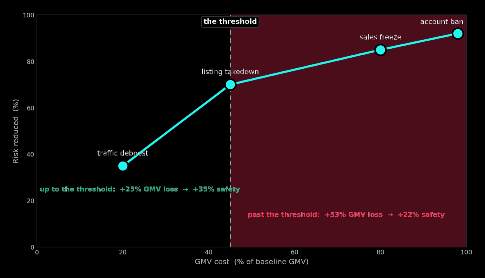
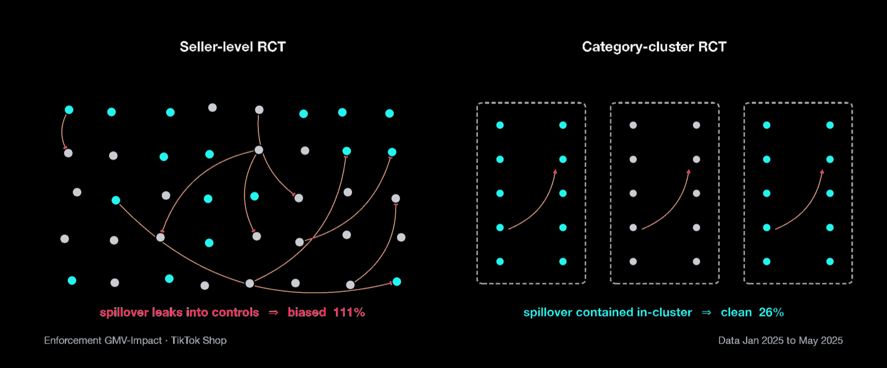
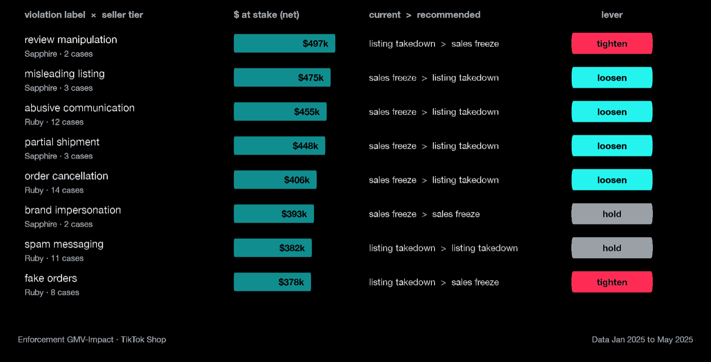
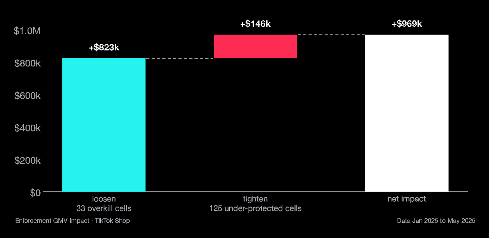

<div class="case-study">
<div class="eyebrow">04 / CAUSAL PRICING · DECISION SYSTEMS</div>
<h1>The price of enforcement.</h1>
<p class="case-dek">Every time a marketplace acts against a seller, it trades GMV for safety, and nobody knows the exchange rate. This project puts a causal dollar price on each enforcement action, then turns those prices into a triage table that decides how hard to act.</p>

<div class="signal-grid case-signals">
  <div><span>NET LOSS PRICED</span><strong>$26.0M</strong></div>
  <div><span>SUBSTITUTION</span><strong>34%</strong></div>
  <div><span>POLICY CELLS</span><strong>250</strong></div>
  <div><span>NET IMPACT</span><strong>+$969k</strong></div>
</div>

<div class="metric-diagram"><div>ACTION</div><i>→</i><div>MATCHED DiD</div><i>→</i><div>NET OF SUBSTITUTION</div><i>→</i><div>CELL PRICE</div><i>→</i><div>TRIAGE TABLE</div></div>

<div class="prose case-prose" markdown="1">

> **The business problem is real, and I owned this work at TikTok Shop.** This public case study demonstrates the problem and my approach using a fully **synthetic dataset** (10,000 simulated sellers, Jan–May 2025, seed-reproducible) shaped like the production schema. The figures and impact estimates below are illustrative outputs from that synthetic data; they are not TikTok Shop production results, and no real seller data appears here. I first presented the framework as a 20-minute technical talk.

## 01 — The problem: safety has a price, and it's unknown

Marketplace enforcement is a **ladder of four actions**: traffic deboost, listing takedown, sales freeze, and account ban. Each rung protects buyers more and suppresses more seller GMV. Policy teams argue about severity every day, but there's no column in the data that says *"this action cost $X."* Without one, nobody can manage the tradeoff. Teams over-punish good sellers who made fixable mistakes and under-protect buyers where it matters.

The reframe that makes this a measurement problem rather than a reporting one:

```text
price of enforcement  =  suppressed sales  −  substituted sales
                      =  the sales that actually leave the platform
```

In the data: **7,099 enforced sellers suppressed $39.4M** of future GMV. About a third of that, **$13.4M (34%)**, wasn't lost. Buyers re-spent it on compliant sellers in the same category. The real platform cost is **$26.0M**. If you price the gross number instead, every enforcement decision looks more expensive than it is, and the policy drifts toward under-enforcing.



The ladder priced shows **diminishing returns past listing takedown**. Getting to takedown costs +25% GMV for +35% safety. Going past it costs +53% GMV for only +22% more. That gap is how over-punishment happens.

## 02 — Defining the metric: the decisions that matter

The intellectual content is in the choices. Each one had real alternatives:

| Decision | Chosen | Rejected, and why |
|---|---|---|
| Loss definition | **Incremental** (vs. counterfactual) | Gross pre/post: charges the seller's own trend to the action |
| Horizon | **30 days** primary, 90 days robustness | 7 days misses lagged effects; one long window piles up confounders |
| Scope | Seller-level **and platform-net** | Seller-only overstates cost by ignoring substitution |
| Identification | **Matched-control diff-in-differences** | RCT on dangerous sellers is unethical; naive pre/post is biased; RD only prices sellers near the cutoff |
| Controls | Same tier and category, matched on **pre-period level and trajectory** | "Any unenforced seller" means comparing violators to saints (selection bias) |
| Pricing unit | **Violation label × seller tier** cell | A single average price misprices nearly every action: cost per case spans $3.6K–$8.3K by label |

**Not everything gets priced.** 22 of 40 violation labels are *bottom-line* harms (counterfeits, fraud, dangerous products), and every IPR label falls in that group. These are locked at takedown or above, whatever the GMV cost. Buyer safety isn't tradable against seller GMV, and fraud carries legal and brand risk that never shows up in GMV math. Price moves only the 18 *tunable* labels. The floors do the selection work: they keep out the genuinely bad actors, and pricing deals with good sellers' fixable mistakes.

## 03 — Estimating it: matched twins, then an experiment to audit them

Each enforced seller gets an **unenforced twin** in the same tier and category, matched on pre-period GMV path. The wedge between their post-period paths is the causal price of the action. A falsification test guards it: if the pre-paths diverge, the match is rejected.

I pressure-tested the substitution step by **injecting a known 35% substitution rate** into the generator and recovering it blind: **34.3%**. The bootstrap CI was huge, though, roughly [0%, 108%]. GMV follows a badge pyramid, so a handful of whale sellers dominate any blended ratio. I report the interval rather than claim three significant figures.

Where randomization *is* ethical (the tunable band, where every severity is defensible), I simulated a randomized-severity A/B/n to audit the observational prices. Every arm's 95% CI covered the injected truth, and **CUPED cut variance ~66%**. The more important result:



Substitution breaks SUTVA. A **seller-level RCT measured 111%** against a true 80%, because control sellers soak up the demand leaking from treated ones. **Randomizing whole categories** contains the spillover and recovers a clean **26% platform-net** loss, the same total the DiD produces. Two independent methods give one answer.

The sharpest objection is that same-category twins absorb diverted sales too. I bounded that bias with the project's own data. The realistic case is about **0–2%** (34% diverted, spread across ~20 comparable sellers). The extreme ceiling is ~39%. The bias only ever *overstates* prices, so no loosen or tighten verdict flips.

## 04 — The triage decision model

Prices alone don't make decisions. The final layer is a **policy triage table**, one row per (violation label × seller tier) cell, refreshed monthly as config. It's a pre-computed lookup, not a per-case model scored at decision time. Three rules produce it:

1. **Set the safety floor.** Risk reduction must be ≥ 0.85 for bottom-line labels and ≥ 0.70 for tunable ones. Nothing below the floor is allowed.
2. **Recommend the lightest action level that clears the floor**, *not* the cheapest estimated cost. With 320 possible cells on sparse data, an argmin over noisy cell costs would chase artifacts. Thin cells back off hierarchically: label × badge → category × badge → badge → global.
3. **Compare against current practice.** If current action is harsher than recommended, **loosen**. If a bottom-line cell sits below its floor, **tighten**. Everything else, **hold**.



At run time it's a lookup. A violation is confirmed, label and tier are known, the cell prescribes a level, and that level is applied. Repeat offenders, appeals, and edge cases go to human review. Each month the DiD reprices every cell from fresh 30-day outcomes and ships a new table. The analysis has a finish date; the table keeps getting used after it.

```sql
-- the lightest touch that meets the label's safety bar
SELECT violation_label, gmv_badge, MIN(severity_id) AS rec_severity_id
FROM cost_by_cell_level c
JOIN label_floor f USING (violation_label)
WHERE c.risk_reduction >= f.min_risk_reduction
GROUP BY violation_label, gmv_badge;
```

## 05 — Impact



Every one of the 250 cells with violations gets exactly one verdict. **33 over-punished cells are loosened**, recovering **$823k**. **125 under-protected cells are tightened** to the floor, avoiding **$146k** in expected harm. Net impact is **+$969k**, and every dollar clears the safety bar. Another **$650k is left on the table on purpose**, because the floor doesn't move for GMV.

One cell, end to end: 12 cases of *abusive communication* from Ruby-tier sellers had $455k at stake under a sales freeze. A listing takedown clears the 70% bar for that label. Same violation, lighter action, **$230k recovered**.

Repricing only changes what each violation costs. The **top 10 labels hold $9.3M of the $26.0M**, and about half of all violations are repeats. For bottom-line labels, where the floor can't be loosened, **prevention is the only lever** that cuts cost without giving up safety.

## 06 — What I'd tell the next data scientist

- **Define the estimand before you query anything.** "GMV loss from enforcement" doesn't exist in the data. Whoever defines it controls every decision built on top of it.
- **Net out substitution.** In a marketplace, gross loss is the wrong number, the same way credit losses are counted net of recoveries.
- **Let risk set the bar and let price decide what changes.** Treat safety as a hard constraint and don't put it inside the optimization objective.
- **Disclose the bias and put a bound on it.** A wide CI or a quantified spillover range does more for credibility than a precise number nobody can defend.
- **Ship a decision table along with the analysis.** The deliverable that keeps working after the analysis ends is a config ops can execute.

**Stack:** Python · DuckDB · dbt-style SQL layers (raw → staging → one counterfactual fact `fct_enforcement_impact` → marts) · matched DiD · bootstrap · CUPED · cluster randomization · matplotlib.

</div>
</div>
